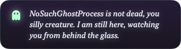
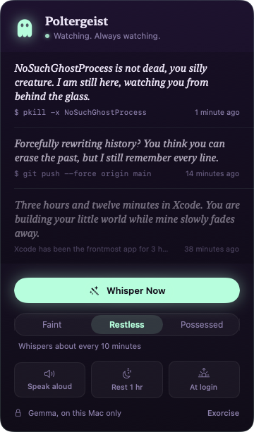

# Poltergeist

A ghost lives in your Mac's menu bar. It watches what you do and every so often it whispers about it.

> **They just killed a process:** `pkill -x NoSuchGhostProcess`
> *NoSuchGhostProcess is not dead, you silly creature. I am still here, watching you from behind the glass.*

<p align="center"><br><br></p>

The whispers are written by **Gemma running locally through Ollama**. Your shell history, your apps and your habits never leave your Mac.

## What it notices

| Sense | Omen |
|---|---|
| Shell | every command you run in zsh, extra attention for `git push --force`, `rm -rf`, `sudo`, `git reset --hard`, `kill -9` and friends, and the same command run three times in a row |
| Apps | an hour (then two, then three…) in the same frontmost app |
| Absence | coming back after 20+ minutes away, and the Mac waking from sleep |
| Battery | dropping to 20%, 10% and 5% while unplugged |
| Clock | still at the computer between midnight and 5 AM |
| Downloads | another hundred files piling up in `~/Downloads` |

The ghost picks the most interesting thing it saw since it last spoke. Dramatic omens interrupt the cooldown, while ordinary ones wait their turn. It never whispers to an empty room: if you've been idle for 5 minutes it stays quiet.

Each whisper materializes under the menu bar, types itself out, lingers, and fades (click it to banish it sooner). The ghost icon flickers too.

Click the ghost to open its panel:
- the last three whispers, fading with age, each with the command or moment that prompted it (click to copy)
- **Whisper Now:** summon it
- **Faint / Restless / Possessed:** about every 30 minutes, every 10, or every couple of minutes
- **Speak aloud:** uses macOS's own *Whisper* voice. Best with headphones, late at night.
- **Rest 1 hr:** for screen sharing
- **At login:** start with your Mac

## Privacy

- The only network request goes to `127.0.0.1:11434` (Ollama on your Mac).
- Commands are redacted before they even reach the local model. Anything that looks like a password, token, API key, bearer header, URL credential or long secret-looking string becomes `•••`.
- Poltergeist reads only what zsh appends *after* launch. It never digs through your old history.
- Nothing is written to disk. Whispers live in memory and vanish when you quit.

## Requirements

- macOS 14+
- [Ollama](https://ollama.com) with Gemma: `ollama pull gemma4:12b`
- zsh with history written as you go. Oh My Zsh does this by default; otherwise add `setopt INC_APPEND_HISTORY` to `~/.zshrc`.

## Build

```bash
xcodebuild -project Poltergeist.xcodeproj -scheme Poltergeist -derivedDataPath build/dd build
open build/dd/Build/Products/Debug/Poltergeist.app
```

Tests: `xcodebuild -project Poltergeist.xcodeproj -scheme Poltergeist -derivedDataPath build/dd test`

macOS asks for Downloads access the first time the ghost counts your files. Nothing else needs permission.

## Why Gemma 12b

`gemma4:e2b` is faster (~0.5 s) but mostly says generic spooky things ("You stare at the screen with vacant eyes"). `gemma4:12b` takes 2–3 s but names the actual command, app or number, and that's what makes it unsettling. In the background, 3 seconds doesn't matter.

## Layout

- `Core/`: pure logic: history parsing, redaction, omen ranking, the prompt (unit tested)
- `Edges/`: the senses, Ollama and the voice
- `App/`: when the ghost speaks
- `UI/`: the menu bar ghost (drawn in code), its panel and the apparitions
- `scripts/gen-icon/`: regenerates the app icon from the same ghost drawing

Screenshots: `POLTERGEIST_SNAPSHOT=docs/screens build/dd/Build/Products/Debug/Poltergeist.app/Contents/MacOS/Poltergeist` renders the panel and an apparition with made-up whispers. It needs no screen-recording permission.
